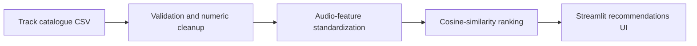

# Spotify-Style Music Recommender

[](https://github.com/b-amit11/spotify-recommender/actions/workflows/ci.yml)

A content-based music recommendation app that finds similar tracks from audio features such as danceability, energy, valence, tempo, and acousticness. It includes a Streamlit interface and a small demo catalogue so it runs immediately after installation.

**Stack:** Python · pandas · NumPy · Streamlit · pytest · GitHub Actions

> This is an independent educational project; it does not use or claim affiliation with Spotify's services or branding.

## Features

- Recommends tracks using cosine similarity over standardized audio features.
- Lets users control the number of recommendations and filter by genre.
- Includes a transparent similarity score and track metadata.
- Accepts a replacement CSV catalogue for experimentation with other datasets.

## Architecture



## Quick start

```bash
python -m venv .venv
source .venv/bin/activate
pip install -r requirements.txt
streamlit run app.py
```

Open the local URL shown by Streamlit (normally `http://localhost:8501`).

## Data format

The app reads `data/tracks.csv`. To use a different catalogue, provide columns named `track_name`, `artist_name`, `genre`, `danceability`, `energy`, `valence`, `acousticness`, and `tempo`.

The bundled catalogue is 12 invented demo tracks. Swap in a larger dataset with the same columns (for example a public Spotify audio-features export) to get meaningful recommendations.

## Tests

```bash
pip install pytest
python -m pytest -q
```

12 tests cover ranking order, exclusion of the selected track, genre filtering, constant-feature handling, input validation and the bundled catalogue.

## License

[MIT](LICENSE)
